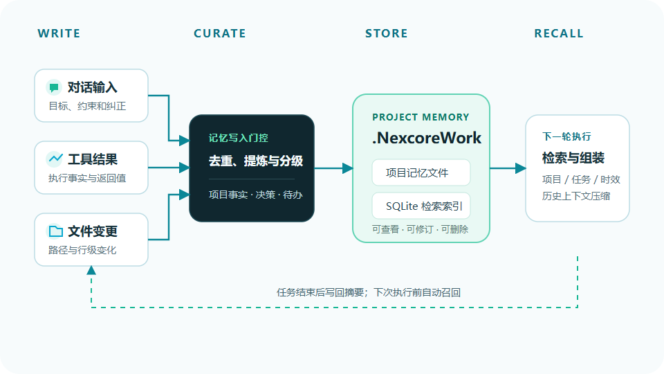

# NexcoreMemory

### “AI 还记得”不是证据。  
### “它为什么想起这条、来自哪里”，才是。

[](https://github.com/yan-stone-computer/NexcoreMemory/actions/workflows/test.yml)
[](LICENSE)
[](https://nodejs.org/)
[](https://sqlite.org/fts5.html)
[](package.json)



NexcoreMemory 是 [NexcoreWork](https://github.com/yan-stone-computer/nexcorework-site)
的可审计长期记忆核心，不是 EchoMora 的 Python 服务，也不是一个“无限上下文”演示。

它只回答一个工程问题：

> 在正确的项目里，针对当前任务，到底应该召回哪几条事实，为什么？

## 为什么不是“全塞进向量库”

常见做法：

```text
query → embedding → top-k → 塞给模型
```

看起来简单，但工程 Agent 会遇到：

- 两个项目的事实互相串；
- 旧决策和新决策同时被召回；
- 一条临时日志压过硬约束；
- 相似记忆重复五遍；
- 召回失败后没人知道为什么；
- 记录一“遗忘”就直接删除。

NexcoreMemory 的链路：

```text
工作区门控
  → FTS5 Top 64
  → 本地低成本语义重排
  → 1–2 跳图谱扩展
  → 混合评分
  → MMR 去重
  → token 预算
  → recall_log 回执
```

## 评分不是玄学

```text
Score =
  0.38 语义相关性
+ 0.17 FTS 相关性
+ 0.15 图谱命中
+ 0.12 重要性
+ 0.08 置信度
+ 0.06 新鲜度
+ 0.04 使用频次
```

固定记忆有额外加成。软遗忘记忆乘 `0.35`。最后用 MMR 惩罚内容重复。

## 30 秒跑起来

```bash
git clone https://github.com/yan-stone-computer/NexcoreMemory.git
cd NexcoreMemory
npm install
npm run check
```

5 项测试覆盖：

- 工作区门控先于 FTS 和图谱；
- FTS5 候选与图谱路径组合；
- 软遗忘保留记录但降低评分；
- `facts.json` 真源往返；
- 召回回执保留原因和路径。

## 最小用法

```ts
import {
  MemoryStore,
  graphForMemory,
  graphRecallPaths,
  rankMemories,
} from "nexcore-memory";

const store = new MemoryStore("./data");
const workspace = "D:/projects/example";

const memory = store.putMemory({
  topic: "Canvas rendering",
  layer: "L3",
  content: "Use Canvas for game.js; do not add runtime dependencies.",
  source: "run-123",
  sourceRunId: "run-123",
  workspace,
  confidence: 0.95,
  importance: 9,
  pinned: true,
});

const graph = graphForMemory(memory);
store.putGraph(memory.id, graph.nodes, graph.edges);

const candidates = store.candidates(question, workspace);
const paths = graphRecallPaths(
  question,
  store.nodes(workspace),
  store.edges(workspace),
  workspace,
);
const result = rankMemories(question, candidates, paths);
```

## 召回回执长什么样

```json
{
  "memoryId": "mem-42",
  "score": 0.82,
  "reasons": [
    "semantic 91%",
    "FTS 100%",
    "graph 50%",
    "pinned"
  ],
  "graphPaths": [
    "Canvas rendering → applies_to → game.js"
  ]
}
```

宿主可以再把来源运行、工具回执和文件路径附上，形成完整的回答证据。

## 项目记忆跟着文件夹走

```text
<workspace>/.NexcoreWork/
  facts.json       结构化事实、节点和边
  memory.md        人类可读摘要
  journal/*.md     宿主追加事件流水
  state.json       压缩与索引状态
```

`facts.json` 是项目事实真源，SQLite 是可重建索引。移动工作区后，事实会重新归属，
索引按新路径重建。

## 生命周期

| 状态 | 行为 |
|---|---|
| `active` | 正常召回 |
| `suppressed` | 软遗忘，保留记录与来源，降低权重 |
| `superseded` | 被新事实替代，保留对比 |
| `deleted` | 明确删除或 TTL 墓碑 |
| `pinned` | 不参与容量随机遗忘 |

## 有意不做的事

- 不接独立 Python 记忆进程；
- 不引入第二套数据库；
- 不搬群聊 UI；
- 不采用好感度/affect 权重；
- 不把哈希向量冒充生产级 embedding；
- 不在全表上跑语义与图谱评分。

如果你有“模型总记错项目事实”的真实案例，欢迎带着脱敏记录来开 Issue。

## 与开放栈组合

- [nexcore-context-governor](https://github.com/yan-stone-computer/nexcore-context-governor)
- [NexcoreFileRead](https://github.com/yan-stone-computer/NexcoreFileRead)
- [NexcoreVision](https://github.com/yan-stone-computer/NexcoreVision)
- [NexcoreToolGuard](https://github.com/yan-stone-computer/NexcoreToolGuard)
- [NexcoreAgent](https://github.com/yan-stone-computer/NexcoreAgent)

## License

MIT
