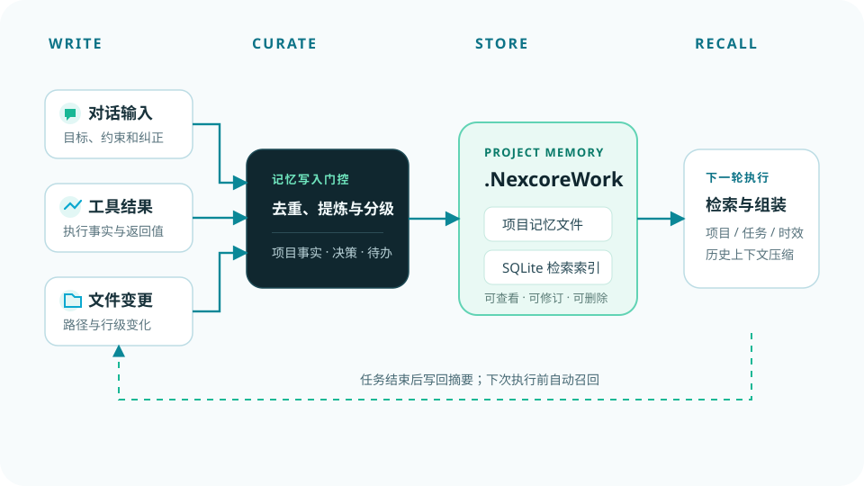

# NexcoreMemory

> Auditable long-term memory for engineering agents. This is the memory architecture extracted
> from NexcoreWork, not a chat demo and not an external memory service.

The design port is deliberately narrow:

- short-term events stay in the host application;
- medium-term facts live in a structured memory table;
- long-term decisions, constraints, files and source runs form a versioned graph;
- FTS5 narrows the candidate set before cheap local semantic reranking;
- hybrid scoring and MMR select the final context;
- soft forgetting lowers recall probability without deleting the record;
- every injected memory keeps a recall receipt with score components, reasons, source and graph path.

The package does **not** include EchoMora's chat UI or affect/affinity model. It also does not
start another Python process or database.



## Recall pipeline

```text
workspace / permission gate
  → FTS5 Top 64
  → local hash-vector rerank
  → 1–2 hop graph expansion
  → hybrid score
  → MMR de-duplication
  → token budget in the host agent
  → recall_log receipt
```

Score:

```text
0.38 semantic + 0.17 FTS + 0.15 graph + 0.12 importance
+ 0.08 confidence + 0.06 freshness + 0.04 frequency
```

Pinned memories receive a stable bonus. Suppressed memories retain their record and source
but are multiplied by `0.35`.

## Quick start

```bash
git clone https://github.com/yan-stone-computer/NexcoreMemory.git
cd NexcoreMemory
npm install
npm run check
```

```ts
import {
  MemoryStore,
  graphForMemory,
  graphRecallPaths,
  rankMemories,
} from "nexcore-memory";

const store = new MemoryStore("./data");
const workspace = "D:/projects/example";
const memory = store.putMemory({
  topic: "Canvas rendering",
  layer: "L3",
  content: "Use Canvas for game.js; do not add runtime dependencies.",
  source: "run-123",
  sourceRunId: "run-123",
  workspace,
  confidence: 0.95,
  importance: 9,
  pinned: true,
});

const graph = graphForMemory(memory);
store.putGraph(memory.id, graph.nodes, graph.edges);

const candidates = store.candidates(userQuestion, workspace);
const paths = graphRecallPaths(
  userQuestion,
  store.nodes(workspace),
  store.edges(workspace),
  workspace,
);
const ranked = rankMemories(userQuestion, candidates, paths);
```

## Project memory as a portable source of truth

Use `writeMemoryFacts()` to persist:

```text
<workspace>/.NexcoreWork/
  facts.json       structured records, nodes and edges
  memory.md        human-readable summary
  journal/*.md     append-only event log in the host application
  state.json       compaction/index state in the host application
```

`facts.json` is the durable project truth. SQLite is the searchable index and can be rebuilt
after moving a workspace. The host application remains responsible for its event journal and
the final context budget.

## Lifecycle

- `active`: normal recall.
- `suppressed`: soft-forgotten; the record, source and graph remain.
- `superseded`: replaced by a newer version but still available for comparison.
- `deleted`: explicit tombstone or TTL cleanup.
- `pinned`: exempt from random/capacity forgetting.

Capacity pressure calls `selectLifecycle()` and suppresses low-value records. Physical deletion
is reserved for TTL expiry or explicit user deletion.

## Limits

- Hash vectors are deterministic lexical-semantic features, not a replacement for a trained
  embedding model.
- FTS5 is the candidate gate; do not run graph or semantic scoring over the full database.
- Graph extraction is intentionally conservative. Hosts can add richer symbol/dependency edges.
- `recall_log` contains the user query and selected sources; store it locally and apply retention
  policy appropriate to the host.

## Related Nexcore open results

- [nexcore-context-governor](https://github.com/yan-stone-computer/nexcore-context-governor)
- [NexcoreVision](https://github.com/yan-stone-computer/NexcoreVision)
- [NexcoreFileRead](https://github.com/yan-stone-computer/NexcoreFileRead)

## License

MIT.
